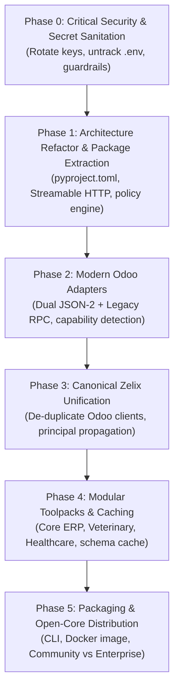
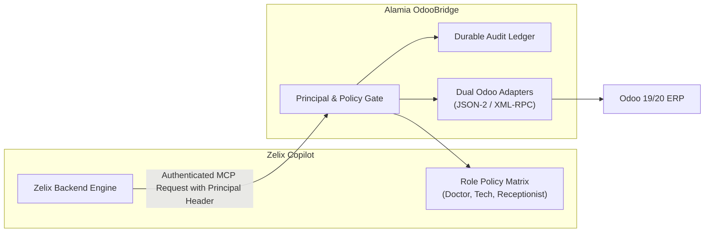

# Alamia OdooBridge: Engineering & Productization Plan

**Product Name:** **Alamia OdooBridge**  
**Tagline:** *The Independent Integration Gateway for Odoo & AI Agents*  
**Baseline Document:** [`docs/Alamia-Odoo-Bridge/review.md`](file:///e:/myapps/odoo-mcp/docs/Alamia-Odoo-Bridge/review.md)  
**Target Outcome:** Transform the internal FastMCP prototype into an enterprise-grade, secure, multi-version integration layer serving ZelixVet, Stratos HMS, TravelOS, and standalone AI agents.

---

## 1. Executive Summary & Strategic Alignment

The technical review delivers a crucial insight:
> *The most valuable asset is not the ten raw MCP tools. It is having one standardized, secure, independently deployable Odoo connectivity layer serving multiple Alamia products and customer environments.*

We are adopting the review's core recommendations:
1. **Name & Identity:** Rebrand to **`Alamia OdooBridge`** (focused specifically on Odoo integration, security, and interoperability—not an overextended "Universal ERP Gateway").
2. **Three-Layer Architecture:**
   - **Layer 1 (OdooBridge Runtime):** Connectivity, JSON-2 / RPC adapters, security policies, caller identity, and audit logging.
   - **Layer 2 (Capability Registry):** Business abstractions (`patient_360`, `booking_readiness`, `customer_360`).
   - **Layer 3 (AI Workflows):** ZelixVet, Stratos HMS, TravelOS, and external agents (Cursor, Claude Desktop).
3. **Internal Dogfooding First:** Before publishing to PyPI or marketing to external developers, prove that ZelixVet can run 100% of its clinical workflows through this bridge with unified credentials and zero regression.

---

## 2. Phased Implementation Roadmap



---

### Phase 0: Immediate Security Hardening & Secret Sanitation (P0)

**Goal:** Eliminate credential leak vectors and lock down destructive tool capabilities.

1. **Repository Secret Scrub & Git Clean-up**:
   - Untrack root `.env` from git (`git rm --cached .env`) and add strict `.gitignore` rules.
   - Scrub and rotate any committed secrets/tokens (including `BITNET_API_KEY` in examples).
   - Ensure `odoo_client.py` defaults fail fast if credentials are not explicitly supplied (remove hardcoded `admin/admin`).
2. **Remote Endpoint Protection**:
   - Implement bearer token / API key authentication on the bridge's HTTP/SSE endpoint (do not expose an unauthenticated bridge on `0.0.0.0:8008`).
   - Bind to local container networks or require authorization headers on all incoming requests.
3. **Safe Operation Policies (Destructive Guardrails)**:
   - **Restrict `odoo_unlink_record`**: Disable generic deletes by default; require explicit administrative flags or human-in-the-loop confirmation.
   - **Sandbox `odoo_execute_method`**: Disallow arbitrary method calls; introduce an explicit allowlist of safe business methods (`action_confirm`, `button_validate`, `get_dashboard_data`).
   - **Standardize MCP Tool Error Semantics**: Return proper MCP `isError: true` responses instead of swallow-and-return `{ "success": false }` dictionaries.

---

### Phase 1: Package Extraction & Transport Modernization (P1)

**Goal:** Extract `mcp-server/` into a versioned, testable Python package (`alamia-odoobridge`).

1. **Package Directory Structure**:
   Extract `mcp-server/` into a structured, standards-compliant layout:
   ```
   packages/alamia-odoobridge/
   ├── pyproject.toml              # Dependencies pinned (fastmcp, pydantic, requests, httpx)
   ├── README.md
   ├── Dockerfile
   ├── src/alamia_odoobridge/
   │   ├── __init__.py
   │   ├── cli.py                  # CLI entrypoint for stdio / remote
   │   ├── config.py               # Pydantic Settings & environment validation
   │   ├── core/
   │   │   ├── interfaces.py       # Abstract Base Adapter
   │   │   ├── policies.py         # Read-only / Controlled writes / Workflow modes
   │   │   └── audit.py            # Bridge-level structured audit logger
   │   ├── adapters/
   │   │   └── odoo/
   │   │       ├── base.py
   │   │       ├── connection.py   # Thread-safe connection pool with timeouts
   │   │       └── xmlrpc.py
   │   └── mcp/
   │       ├── server.py           # FastMCP server definition
   │       └── transports.py       # Transport manager
   └── tests/
       ├── unit/
       └── integration/
   ```
2. **Transport Modernization**:
   - Support **Streamable HTTP** as the modern remote standard.
   - Support **stdio** for local IDEs (Claude Desktop, Cursor).
   - Maintain **SSE** as backward-compatible transport for Zelix Copilot.
3. **Connection Pool & Concurrency**:
   - Replace globally cached `ServerProxy` with thread-safe, timeout-managed connection instances (`timeout=30s`, exponential backoff for read operations).

---

### Phase 2: Dual Odoo Adapters (JSON-2 & Legacy RPC) (P1)

**Goal:** Future-proof the bridge for Odoo 19+ and Odoo 20 while maintaining backward compatibility with Odoo 14–18.

1. **Transport-Independent Adapter Interface**:
   ```python
   class BaseOdooAdapter(ABC):
       @abstractmethod
       async def authenticate(self) -> int: ...
       @abstractmethod
       async def search_read(self, model: str, domain: list, fields: list, ...) -> list[dict]: ...
       @abstractmethod
       async def create(self, model: str, values: dict) -> int: ...
       @abstractmethod
       async def write(self, model: str, ids: list[int], values: dict) -> bool: ...
       @abstractmethod
       async def execute_kw(self, model: str, method: str, args: list, kwargs: dict) -> Any: ...
   ```
2. **Implement Dual Adapters**:
   - **`XmlRpcAdapter`**: For Odoo 14–18, and Odoo 19/20 legacy compatibility.
   - **`Json2Adapter`**: Native HTTP client using Odoo 19's External JSON-2 API with API keys. Handles named argument translation for Odoo methods.
3. **Runtime Capability & Entitlement Detection**:
   - Inspect server version and probe endpoints during handshake (`/xmlrpc/2/common` vs `/json2/`).
   - Validate whether the configured account and subscription plan permit external API calls.

---

### Phase 3: Canonical Zelix Unification & Principal Propagation (P1)

**Goal:** Eliminate redundant Odoo clients across the repo and ensure Zelix runs through the canonical bridge.



1. **De-duplicate Connectivity**:
   - Deprecate `zelix_odoo_adapter.py` direct XML-RPC calls in `zelix-copilot-backend/`.
   - Wire Zelix's orchestrator and workflows directly to the `OdooBridgeClient`.
2. **Caller Principal Propagation**:
   - Forward the human user's context (e.g. `user_id`, `role`, `company_id`) in request headers.
   - Enforce that a Receptionist cannot trigger veterinarian prescription workflows, even if the underlying Odoo service token has elevated rights.
   - Log both human caller and service account in every bridge audit entry.

---

### Phase 4: Modular Toolpacks & Metadata Caching (P2)

**Goal:** Elevate raw database CRUD into high-level business capabilities.

1. **Modular Toolpack Architecture**:
   - **`core_erp` Toolpack**: Partners, Sales Orders, Quotations, Products, Stock Quants, Invoices.
   - **`veterinary` Toolpack (for ZelixVet)**: `patient_360`, `clinical_consult`, `appointment_reschedule`, `rx_safety_check`.
   - **`healthcare` Toolpack (for Stratos HMS)**: `inpatient_admission`, `bed_board`, `vital_signs`, `nurse_handoff`.
   - **`accounting` Toolpack**: Financial summary, unpaid invoice reminder, reconciliation status.
2. **Schema Metadata Caching**:
   - Cache `ir.model` and `ir.model.fields` definitions in memory with TTL (e.g. 1 hour).
   - Invalidate on module installation/upgrade events.
   - Eliminates redundant schema round-trips when agents inspect models.

---

### Phase 5: Packaging & Open-Core Distribution (P3)

**Goal:** Create a distributable developer package and clear commercial boundaries.

1. **Edition Matrix**:
   - **Community Edition (Open Source)**:
     - Standalone stdio & Streamable HTTP server.
     - Dual JSON-2 / XML-RPC adapters.
     - Core ERP discovery & CRUD tools.
     - Basic security allowlisting.
   - **Alamia Enterprise Edition (Commercial / Internal)**:
     - Multi-tenant connection pooling.
     - Role-based Principal Propagation & HIPAA/GDPR audit ledger.
     - Domain Toolpacks (Veterinary, Hospital, Accounting).
     - Schema caching & rate limiting.
2. **Distribution Channels**:
   - PyPI package (`pip install alamia-odoobridge` / `uvx alamia-odoobridge`).
   - Official container on GitHub Packages (`ghcr.io/vextersoft/alamia-odoobridge`).

---

## 3. Immediate Action Plan (Sprint 1: Security & Foundation)

| Step | Action Item | Target File / Area | Output |
|---|---|---|---|
| **1** | Clean tracked `.env` and rotate default passwords | `.env`, `.gitignore`, `docker-compose.yml` | Zero secrets in repo tracking |
| **2** | Add allowlist policies & disable unvetted `unlink`/`execute_method` | `mcp-server/server.py` | Guardrails against destructive agent actions |
| **3** | Add application authentication token for port 8008 | `mcp-server/server.py` | Secure remote endpoint |
| **4** | Package scaffold with `pyproject.toml` and pinned dependencies | `packages/alamia-odoobridge/` | Reproducible package build |
| **5** | Implement initial `tests/test_bridge_security.py` | `packages/alamia-odoobridge/tests/` | Automated verification harness |
