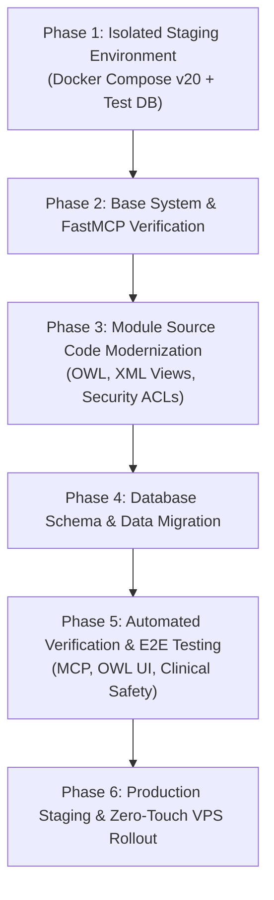

# Odoo 20.x Migration & Architectural Upgrade Plan

**Branch:** `odoo-20-upgrade`  
**Current Baseline:** Odoo 19.0 Community (Docker, PostgreSQL 16)  
**Target Version:** Odoo 20.x Community  
**Scope:** Core ERP Platform, In-Odoo MCP Layer, FastMCP Standalone Gateway, VetCairn Veterinary Suite, Stratos HMS, Zelix AI OWL UI, and Addon Ecosystem.

---

## 1. Executive Summary & Context

During recent analysis of newly received addons (`stratos_social` v20.0.1.2.0 and `stratos_crm_rfp` v20.0.1.1.0), several key architectural conventions of Odoo 20.x were identified:
1. **Next-Generation OWL Framework**: Transitions toward reactive proxies (`proxy` replacing `useState`), component-level property bindings (`useProps`), and action plugin structures (`@web/webclient/actions/action_plugin`).
2. **Simplified ACL Specifications**: Introduction of unified access declarations (`ir.access.csv` with `operation,domain` format alongside `res.groups.privilege`).
3. **Typed ORM Configuration Utilities**: Native typed getters on `ir.config_parameter` (`.get_str()`, `.get_int()`).
4. **View Refinements**: Continued standardization of `<list>` tags and modular card templates in `<kanban>`.

This upgrade plan outlines the end-to-end strategy to transition the entire clinical system, FastMCP bridges, and all custom modules to Odoo 20.x while maintaining the **Strict Zero-Touch VPS Deployment** and **Alamia White-Label Branding** invariants.

---

## 2. Component Impact & Audit Inventory

| Component / Addon | Current Version | Odoo 20.x Compatibility State | Critical Areas to Audit |
|---|---|---|---|
| **`odoo_web` (Docker)** | `odoo:19.0` | Needs image upgrade to `odoo:20.0` | Python 3.12/3.13 dependencies, base Debian libraries |
| **`mcp_server` (In-Odoo)** | `19.0.2.1.0` | High Priority | `/mcp` HTTP endpoint, OAuth 2.1 auth flow, `ir.model.access` |
| **FastMCP Server (`mcp-server/`)** | `FastMCP 4.0.2` | Low Risk (Independent) | XML-RPC / JSON-RPC client wrappers, model reflection |
| **`VetCairn` Suite (22 modules)** | `19.0.1.0.0` | Medium Risk | Tree-to-list view definitions, OWL dashboard, calendar views |
| **`stratos_hms`** | `19.0.1.0.0` | Medium Risk | Command Center OWL action, EWS badge, Scribe field widget |
| **`zelix_ai`** | `19.0.1.0.0` | High Risk (OWL UI) | Systray launcher, slide-out drawer, Action Card OWL components |
| **`stratos_vet_case_memory_suite`** | `19.0.1.0.0` | Medium Risk | Voice dictation widget, SOAP exam bridge, vector RAG hooks |
| **`stratos_crm_rfp`** | `20.0.1.1.0` | Native 20.x | Native OWL 20 dashboard; revert backward-compatibility shims |
| **`stratos_social`** | `20.0.1.2.0` | Native 20.x | Native Meta/YouTube/TikTok OAuth controllers, native ACLs |

---

## 3. Migration Roadmap (Phased Execution)

---

### Phase 1: Isolated Staging Environment

1. **Docker Compose Staging Definition**:
   - Create a staging compose override file `docker-compose.v20.yml` with:
     - `odoo_web_v20` using `odoo:20.0` (or target build).
     - Separate staging PostgreSQL database `odoo_db_v20` on port `5433` to prevent data pollution.
     - FastMCP test instance `odoo_mcp_v20` targeting port `8009`.
2. **Environment & Dependency Checks**:
   - Verify Python dependencies in `Dockerfile.web`: ensure `cryptography`, `requests`, `fastapi`, and MCP dependencies build cleanly against Python 3.12/3.13.

---

### Phase 2: Base System & FastMCP Verification

1. **Base Platform Boot**:
   - Verify vanilla Odoo 20 initialization with clean database `odoo_v20_test`.
2. **In-Odoo `mcp_server` Module Porting**:
   - Audit controller route decorators (`@http.route`) for signature changes.
   - Verify OAuth 2.1 token issuance and Bearer token parsing in Odoo 20 HTTP dispatcher.
   - Validate standalone FastMCP client (`mcp-server/odoo_client.py`) connectivity over XML-RPC and JSON-RPC.

---

### Phase 3: Addon Codebase Modernization

1. **Frontend & OWL Component Evolution**:
   - Update `zelix_ai` components (`copilot_systray.js`, `copilot_sidebar.js`, `action_card.js`) to target Odoo 20 OWL standards.
   - Modernize `rfp_dashboard.js` back to native Odoo 20 patterns (`useProps`, `action_plugin`).
   - Audit `stratos_hms` widgets (`command_center.js`, `ews_badge.js`, `scribe_field.js`).
2. **XML View Alignment**:
   - Convert any remaining legacy `<tree>` declarations across VetCairn and HMS to `<list>`.
   - Update kanban card templates to use Odoo 20 `<t t-name="card">` guidelines.
3. **Security & ACL Harmonization**:
   - Review `ir.model.access.csv` vs `ir.access.csv` compatibility across all modules.
   - Standardize `res.groups.privilege` definitions across all healthcare packages.

---

### Phase 4: Database Schema & Data Migration

1. **Schema Upgrade Path**:
   - Utilize OpenUpgrade 20.0 (when published by OCA) or orchestrated migration scripts (`scripts/migrate_v19_to_v20.py`).
2. **Clinical Data Preservation**:
   - Prioritize zero loss on:
     - VetCairn patients (`vet.patient`), encounters (`vet.encounter`), prescriptions (`vet.prescription`).
     - Stratos HMS medical records (`hms.patient`, `hms.visit`, `hms.consult`, `hms.case.memory`).
     - Institutional learned rules (`zelix.ai.rule`) and audit logs (`zelix.copilot.audit`).
3. **Data Integrity Checks**:
   - Execute pre-migration and post-migration record checksums on critical healthcare models.

---

### Phase 5: Verification & End-to-End Testing

1. **MCP Tool Execution Suite**:
   - Run `scripts/test_mcp.py` to confirm all core AI tools (`execute_kw`, `search_read`, `create_record`, `update_record`) operate with exact fidelity.
2. **Clinical Action Card & Scribe Workflow Verification**:
   - Validate pre-consult summaries, SOAP scribe generation, and Rx interaction guards.
   - Verify the `zelix_service` system account auto-provisions and maintains admin group rights.
3. **Asset Bundle Compilation**:
   - Ensure clean asset generation without warnings in `web.assets_backend`.

---

### Phase 6: Zero-Touch VPS Deployment Strategy

Per **AGENTS.md Invariant 3 (Strict Zero-Touch VPS Deployment)**:
1. All updates must be fully automated without interactive SSH/bash sessions.
2. Container entrypoint (`docker-entrypoint.sh`) and self-healing ORM script (`scripts/setup_odoo_mcp_orm.py`) must handle:
   - Automated database backup prior to migration.
   - Module upgrades via `-u all` or explicit module list iteration.
   - Cache clearing and web asset bundle regeneration.
3. Git deployment triggered via Portainer stack webhook / redeployment.

---

## 4. Risk Assessment & Mitigation

| Risk | Severity | Probability | Mitigation Strategy |
|---|---|---|---|
| **Breaking OWL Framework Changes** | High | High | Isolate OWL components in staging; maintain test harness with Playwright/DevTools. |
| **OpenUpgrade Delay for v20** | High | Medium | Author direct SQL/ORM migration scripts for custom `vet.*`, `hms.*`, and `zelix.*` tables. |
| **OAuth / Security Header Changes** | Medium | Medium | Validate `mcp_server` controllers in Phase 2 before migrating business addons. |
| **Downtime during VPS Stack Upgrade** | High | Low | Automated rollback hook to Odoo 19 image if health check fails within 300 seconds. |

---

## 5. Branch Strategy & Governance

- **Target Branch:** `odoo-20-upgrade` (dedicated staging and development).
- **Merge Criteria to `main`:**
  - 100% test pass rate on `scripts/test_mcp.py`.
  - Zero asset compilation errors.
  - Successful dry-run migration on a cloned production database.
  - Approval and sign-off on updated architecture records.
