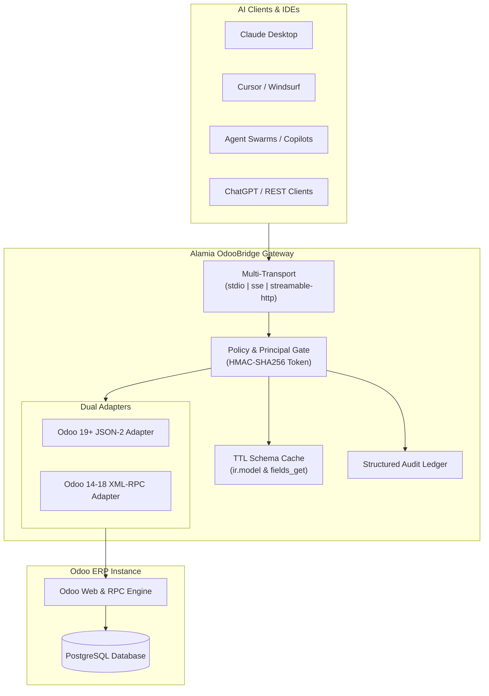

<div align="center">

# Alamia OdooBridge

### The Independent Integration Gateway for Odoo ERP & AI Agents

[](LICENSE)
[](pyproject.toml)
[](https://modelcontextprotocol.io)
[](https://gofastmcp.com)
[](docs/architecture.md)

**Connect Claude Desktop, ChatGPT, Cursor, Windsurf, and Autonomous AI Agent Swarms to Odoo ERP instances through a secure, guarded, and version-agnostic Model Context Protocol (MCP) gateway.**

[Quickstart](#quickstart) • [Claude Desktop](#claude-desktop-setup) • [Cursor / Windsurf](#cursor--windsurf-setup) • [Docker Deployment](#docker-deployment) • [Tools & Guardrails](#guarded-mcp-tools) • [Architecture](#architecture)

</div>

---

## Why Alamia OdooBridge?

Connecting large language models directly to enterprise ERP databases requires strict policy boundaries. **Alamia OdooBridge** provides:

- **Guarded Operations by Default**: Destructive `unlink` (record deletion) is disabled by default. Business methods require explicit model:method allowlisting.
- **Dual Odoo Adapters**: Modern native **External JSON-2 HTTP API** for Odoo 19+ and thread-safe **XML-RPC** for Odoo 14-18.
- **In-Memory TTL Schema Cache**: Caches `ir.model` and `fields_get` introspection metadata to reduce redundant latency.
- **Cryptographic Caller Verification**: HMAC-SHA256 signed caller principal verification with expiry and replay protection, paired with structured operational audit logging.
- **Multi-Transport**: Works over `stdio` (local IDEs), `streamable-http`, and `sse` (remote Docker / cloud agents).

---

## Quickstart

### 1. Installation

```bash
pip install alamia-odoobridge
```
*Or run directly with uv without installing:*
```bash
uvx alamia-odoobridge --help
```

### 2. Run Stdio Server (for IDEs)
```bash
alamia-odoobridge --transport stdio --url http://localhost:8069 --db odoo_hospital --user admin --password secret
```

### 3. Run Remote SSE Gateway (Port 8008)
```bash
alamia-odoobridge --transport sse --port 8008
```

---

## Claude Desktop Setup

Connect Claude Desktop to your local or remote Odoo ERP in under 2 minutes:

1. Open `%APPDATA%\Claude\claude_desktop_config.json` (or **Settings** -> **Developer** -> **Edit Config** in Claude Desktop).
2. Add the `alamia-odoobridge` server:

```json
{
  "mcpServers": {
    "alamia-odoobridge": {
      "command": "python",
      "args": [
        "-m",
        "alamia_odoobridge.cli",
        "--transport",
        "stdio"
      ],
      "env": {
        "ODOO_URL": "http://localhost:8069",
        "ODOO_DB": "odoo_hospital",
        "ODOO_USERNAME": "zelix_service",
        "ODOO_PASSWORD": "your_secure_password",
        "BRIDGE_EXECUTION_POLICY": "controlled_writes",
        "BRIDGE_ALLOW_UNLINK": "false",
        "BRIDGE_ENABLE_SCHEMA_CACHE": "true"
      }
    }
  }
}
```

3. Restart Claude Desktop. You will see 10 Odoo ERP tools available in your tool tray.

---

## Cursor & Windsurf Setup

Create `.cursor/mcp.json` or `.codeium/windsurf/mcp_config.json` in your workspace:

```json
{
  "mcpServers": {
    "alamia-odoobridge": {
      "command": "python",
      "args": ["-m", "alamia_odoobridge.cli", "--transport", "stdio"],
      "env": {
        "ODOO_URL": "http://localhost:8069",
        "ODOO_DB": "odoo_hospital",
        "ODOO_USERNAME": "zelix_service",
        "ODOO_PASSWORD": "your_secure_password"
      }
    }
  }
}
```

---

## Docker Deployment

Run Alamia OdooBridge as a lightweight, independent microservice gateway:

```bash
docker run -d \
  --name alamia_odoobridge \
  -p 8008:8008 \
  -e ODOO_URL="http://web:8069" \
  -e ODOO_DB="odoo_hospital" \
  -e ODOO_USERNAME="zelix_service" \
  -e ODOO_PASSWORD="your_secure_password" \
  -e MCP_TRANSPORT="sse" \
  ghcr.io/alamiasoft/alamia-odoo-bridge:latest
```

Or using `docker-compose.yml`:
```bash
docker compose up -d
```

---

## Guarded MCP Tools

Alamia OdooBridge provides 10 core tools with standardized JSON schemas and guardrail enforcement:

| Tool Name | Type | Description | Guardrail / Policy |
|---|---|---|---|
| `odoo_status` | Read | Checks connection status, ERP version, and schema cache metrics. | Always allowed |
| `odoo_list_models` | Read | Lists available models with optional keyword filtering. | Cached with TTL |
| `odoo_get_model_fields` | Read | Introspects model fields, types, and relational targets. | Cached with TTL |
| `odoo_search_read` | Read | Queries records matching domain criteria with pagination. | Read policy check |
| `odoo_read_records` | Read | Reads specific records by their integer IDs. | Read policy check |
| `odoo_create_record` | Write | Creates a record in a target model. | Blocked in `read_only` |
| `odoo_write_record` | Write | Updates existing records by ID. | Blocked in `read_only` |
| `odoo_unlink_record` | Destructive | Deletes records by ID. | **Disabled by default** (`BRIDGE_ALLOW_UNLINK=False`) |
| `odoo_execute_method` | Action | Executes business logic methods (e.g. `action_confirm`). | **Restricted to Allowlist** |
| `odoo_list_modules` | Read | Inspects installed module capabilities. | Read policy check |

---

## Architecture



---

## Canonical Python Client SDK

Alamia OdooBridge also includes a unified, thread-safe Python client for direct copilot integration:

```python
from alamia_odoobridge.client import OdooClient

client = OdooClient(
    url="http://localhost:8069",
    db="odoo_hospital",
    username="zelix_service",
    password="your_password"
)

# Check version
print(client.get_version())

# Search and read
partners = client.search_read("res.partner", domain=[("is_company", "=", True)], fields=["name", "email"], limit=5)
print(partners)

# Call safe method
client.execute_kw("account.move", "action_post", [[123]])
```

---

## Configuration Reference

All settings can be configured via environment variables or a `.env` file:

| Variable | Default | Description |
|---|---|---|
| `ODOO_URL` | `http://localhost:8069` | URL of the Odoo instance. |
| `ODOO_DB` | `odoo_hospital` | Database name. |
| `ODOO_USERNAME` | `zelix_service` | Odoo login username. |
| `ODOO_PASSWORD` | `""` | Odoo password or API key. |
| `ODOO_ADAPTER` | `auto` | Adapter type: `auto`, `xmlrpc`, or `json2`. |
| `MCP_TRANSPORT` | `sse` | Transport type: `stdio`, `sse`, or `streamable_http`. |
| `MCP_SERVER_PORT` | `8008` | HTTP/SSE server port. |
| `BRIDGE_EXECUTION_POLICY` | `controlled_writes` | `read_only`, `controlled_writes`, or `workflow_execution`. |
| `BRIDGE_ALLOW_UNLINK` | `false` | Master switch for destructive record deletion. |
| `BRIDGE_ENABLE_SCHEMA_CACHE` | `true` | Enables in-memory schema metadata caching. |
| `BRIDGE_SCHEMA_CACHE_TTL_SECONDS` | `3600.0` | Cache time-to-live in seconds. |

---

## Contributing

We welcome contributions from the community. Please read [CONTRIBUTING.md](docs/CONTRIBUTING.md) for details on our code of conduct, development setup, and pull request process.

---

## License

Alamia OdooBridge is open-source software licensed under the [Apache License 2.0](LICENSE).  
Copyright (c) 2026 AlamiaSoft / Alamia AI.
